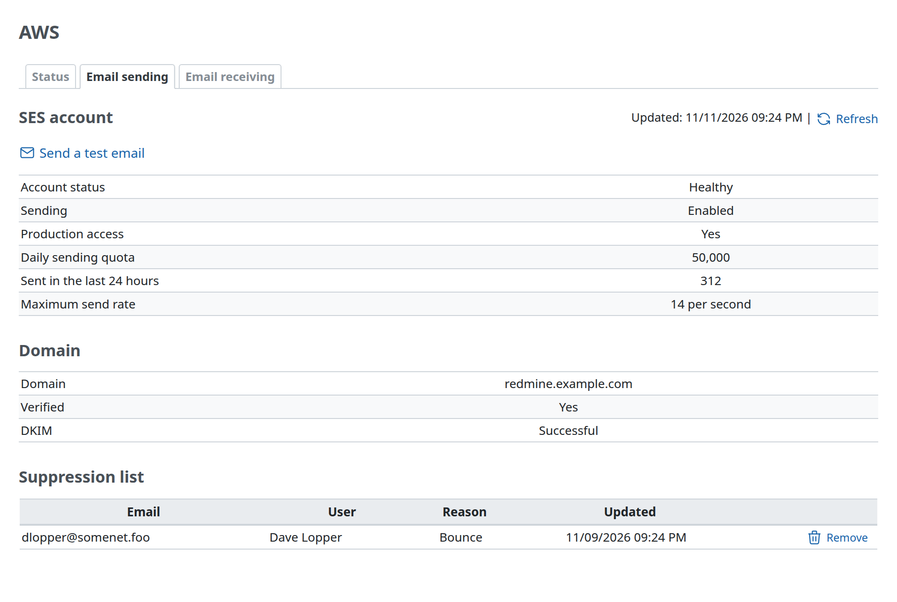
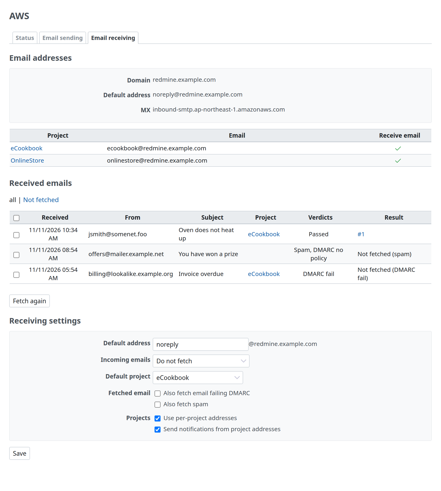
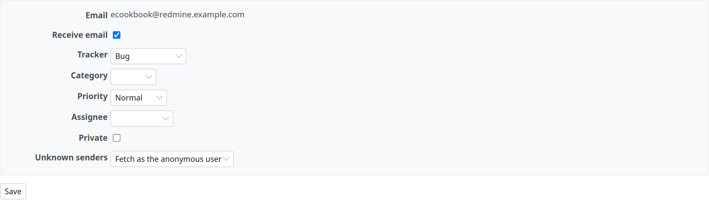

# Administration pages

These are the administration pages of Redmine AWS SES. Only Redmine administrators can open them (`require_admin`), except the project email settings, which people with the project permission that the plugin adds can also change (below). The pages are the "Email sending" and "Email receiving" tabs under the "AWS" item of Redmine's administration menu, which [Redmine AWS](https://redmine-kit.github.io/redmine_aws/admin.html#the-aws-menu) adds and all the Redmine AWS plugins share. The project email settings are a tab in project settings instead.

The specifications in this page were checked against official information and the Redmine 7.0.3 source as of 2026-11-08. Sources are in [sources.md](https://redmine-kit.github.io/serverless/sources.html).

| Item | Details |
| --- | --- |
| No secrets shown | AWS credentials and the bodies of received email are not shown. State from SES and the MX record are cached for 1 minute |
| Settings on the page | Receiving options are plugin settings (Redmine's `Setting.plugin_redmine_aws_ses`, stored in the database) and are changed on the "Email receiving" tab. The plugin list has no "Configure" link |
| Operations are logged | Removing an address from the suppression list, fetching again and changing settings are written to Redmine's log with who did what (`[redmine_aws_ses] <login> ...`) |
| Connection test | The "Connection test" on the "Status" tab of Redmine AWS also calls SES v2 `GetAccount` ([its admin.md](https://redmine-kit.github.io/redmine_aws/admin.html#status)). The result reads "Sending: Enabled, production access: Yes" |

## Email sending

| Item | Contents | Source |
| --- | --- | --- |
| SES account | "Account status" (Healthy, Under review or Paused, from `HEALTHY`, `PROBATION` and `SHUTDOWN`), "Sending" (Enabled or Paused), "Production access" (Yes or No; No means the account is in the sandbox) | SES v2 `GetAccount` |
| Sending limits | "Daily sending quota", "Sent in the last 24 hours", "Maximum send rate" (for example "14 per second") | Same as above |
| Domain | The domain of the emission address in the administration settings, whether it is "Verified", and its DKIM status (Successful, Pending, Failed, Temporary failure or Not started) | SES v2 `GetEmailIdentity` |
| Suppression list | Addresses SES has stopped sending to. Columns: Email, User (the Redmine user who has the address), Reason (Bounce or Complaint), Updated. The first 100 | SES v2 `ListSuppressedDestinations` |
| Remove | A "Remove" button per address of the suppression list, after confirmation | SES v2 `DeleteSuppressedDestination` |
| Send a test email | A link at the top to Redmine's standard "Send a test email" (in "Email notifications" under Administration › Settings). The same feature is not added | — |
| Failed jobs | When Redmine AWS SQS is installed, a link at the top to its "Jobs" page, listing only failed email | — |

| Item | Details |
| --- | --- |
| Why show the suppression list | SES adds an address to the suppression list after a bounce or a complaint, and stops sending to it. From Redmine it looks as if the email was sent, so when someone says "notifications do not arrive", this page lets you check. Remove the address after the cause is fixed |
| Test email | Redmine's standard test email is sent within the page request (`deliver_now`), so `redmine-web` is also given permission to send through SES ([mail.md](https://redmine-kit.github.io/serverless/mail.html#ses)) |

## Email receiving

| Item | Contents | Source |
| --- | --- | --- |
| Email addresses | "Domain" (Redmine's domain: the domain of the emission address), "Default address", "MX" (below), and with per-project addresses, a list of projects (Project, Email, Receive email) | Plugin settings and project email settings |
| MX | The MX hosts of Redmine's domain, to check that they are the SES receiving endpoint. "Unknown" when the lookup fails, "none" when there is no MX record | DNS lookup, with a 2-second timeout |
| Received emails | Received, From, Subject, Project, Verdicts (the SES virus, spam and DMARC verdicts that did not pass, for example "Spam, DMARC fail", or "Passed"; the terms are under "Terms" below), Result (below). The newest 100. "all \| Not fetched" above the list filters it | The plugin's table (below) |
| Fetch again | The check boxes of the list select messages; the check box in the header row selects all, as in Redmine's issue list. "Fetch again" fetches the selected messages again | A job for each message (`AwsSesReimportMailJob`; SQS in Serverless, where `redmine-worker` imports it) |
| Receiving settings | "Default address" (the part before `@`), "Incoming emails" ("Do not fetch", the default, or "Fetch into the default project"; Redmine's own term), "Default project", "Fetched email" ("Also fetch email failing DMARC" and "Also fetch spam", both off by default and best left off: fetching email that fails DMARC lets a forged sender create issues; email with a virus verdict is never fetched), and "Projects" ("Use per-project addresses", "Send notifications from project addresses") | Plugin settings (changed on the page). See [receiving.md](receiving.md#spoofing-and-spam) |

| Result | Meaning |
| --- | --- |
| The issue (for example `#123`) or "Fetched" | Imported: an issue was created or a note added |
| Not fetched (no verdicts) | No verdicts from SES (a message that was never received through the event) |
| Not fetched (virus) | The virus verdict is not `PASS` |
| Not fetched (spam) | The spam verdict is not `PASS`, and "Also fetch spam" is off |
| Not fetched (DMARC fail) | The DMARC verdict is not `PASS`, and "Also fetch email failing DMARC" is off |
| Not fetched (auto-reply) | An auto-reply ([receiving.md](receiving.md#importing)) |
| Not fetched (no project) | No project receives it, or it went to the default address with "Do not fetch" |
| Fetch error | Redmine did not import it (for example, an unknown sender with "Do not fetch", or a sender without permission). Redmine's log has the reason |

| Item | Details |
| --- | --- |
| Import records | `redmine_aws_ses:receive_mail` stores the result for each message in the plugin's table (`aws_ses_received_mails`): the sender, the subject, the envelope recipients and the verdicts from the SES event, the project, and the issue created or the note added. The body is not stored; its key in the mail bucket (`inbound/` or `processed/`) is. Fetching again updates the same record. Records older than 90 days are deleted by `rake redmine_aws_ses:prune_records`, which Serverless runs daily ([security.md](https://redmine-kit.github.io/serverless/security.html#retention-periods)) |
| Email that was not fetched | It stays in `inbound/` and can be fetched again after the cause is fixed |
| Fetch again | The page does not call `redmine-task` directly; it puts a job on the queue. This way `redmine-web` needs no permission to read the mail bucket or to invoke Lambda. With Redmine AWS SQS, the job class is added to the allowed job classes |
| Why receiving settings are on the page | You do not have to deploy each time you change the default project. `redmine_aws_ses:receive_mail` reads the settings from the database on every run |

## Project email settings

An "Email" tab is added to project settings when addresses per project are on. It configures the address per project ([receiving.md](receiving.md#addresses-per-project)). The settings are in the plugin's table (`aws_ses_project_mail_settings`), because Redmine's settings are for the whole Redmine only (`Setting`, a name and a value) and Redmine has no table for per-project settings. Deleting a project deletes its row.

| Item | Contents |
| --- | --- |
| Email | `<identifier>@<Redmine's domain>`. Display only. A project whose identifier cannot be an address shows `-` and cannot receive email ([receiving.md](receiving.md#addresses-per-project)) |
| Receive email | A check box. Off by default |
| Default values | Tracker, Category, Priority, Assignee and Private of created issues |
| Unknown senders | "Do not fetch" (default), "Fetch as the anonymous user" or "Create a user" (Redmine's `unknown_user` values `ignore`, `accept`, `create`) |

| Item | Details |
| --- | --- |
| Who can change it | Redmine administrators and members with the project permission "Manage email settings" that the plugin adds |
| When fetching email from unknown senders | Use this to receive email from outside people, such as for a contact desk. Spam increases, so keep the DMARC check ([receiving.md](receiving.md#spoofing-and-spam)) |

## Permissions

For these pages, the role that runs Redmine's web requests gets permission to read SES status and to remove addresses from the suppression list. The list and an example policy are in [iam.md](iam.md).

## Tests

Each page has Redmine functional tests, with SDK response stubs for SES ([testing.md](https://redmine-kit.github.io/serverless/testing.html#administration-pages)).

The screenshots on this page are taken with `bin/screenshots` (headless Chromium in Docker, with Redmine's test data and example SES answers and received email). Run it after changing a page.

## Terms

The screens use the Japanese terms of the SES console and documentation (checked on 2026-11-10).

| Screen (en / ja) | AWS term | Source | Status |
| --- | --- | --- | --- |
| Account status / アカウントステータス; Healthy / 正常, Under review / レビュー対象, Paused / 一時停止 | `EnforcementStatus` (`HEALTHY`, `PROBATION`, `SHUTDOWN`) | 「アカウントステータス」「正常」「一時停止」「レビュー対象」 in https://docs.aws.amazon.com/ja_jp/ses/latest/dg/faqs-enforcement.html | Documentation |
| Production access / 本稼働アクセス | `ProductionAccessEnabled` | https://docs.aws.amazon.com/ja_jp/ses/latest/dg/manage-sending-quotas.html. A third-party article quotes the console as 「本番アクセス」 (https://blog.serverworks.co.jp/ses-sandbox) | To recheck in the console |
| Daily sending quota / 日次送信クォータ | `SendQuota.Max24HourSend` | https://docs.aws.amazon.com/ja_jp/ses/latest/dg/monitor-sending-activity-console.html | Documentation |
| Maximum send rate / 最大送信レート | `SendQuota.MaxSendRate` | https://docs.aws.amazon.com/ja_jp/ses/latest/dg/monitor-sending-activity-console.html | Documentation |
| Verified / 検証済み | `VerifiedForSendingStatus` | 「検証済み ID」 in https://docs.aws.amazon.com/ja_jp/ses/latest/dg/send-email-authentication-dkim-easy-managing.html | Documentation |
| DKIM: Successful / 成功, Pending / 保留中, Failed / 失敗, Temporary failure / 一時的な失敗, Not started / 未開始 | `DkimAttributes.Status` (`SUCCESS`, `PENDING`, `FAILED`, `TEMPORARY_FAILURE`, `NOT_STARTED`) | The documentation keeps the API values in English; the Japanese values are ours | To recheck in the console |
| Suppression list / サプレッションリスト; Bounce / バウンス, Complaint / 苦情; Remove / 削除 | `ListSuppressedDestinations` (`Reason`: `BOUNCE`, `COMPLAINT`), `DeleteSuppressedDestination` | https://docs.aws.amazon.com/ja_jp/ses/latest/dg/sending-email-suppression-list.html | Documentation |
| Verdicts / 判定: Spam / スパム, Virus / ウイルス, DMARC fail / DMARC 失敗, … undetermined / 判定不能, … scan failed / スキャン失敗, DMARC no policy / DMARC ポリシーなし, Passed / 合格 | `spamVerdict`, `virusVerdict`, `dmarcVerdict` (`PASS`, `FAIL`, `GRAY`, `PROCESSING_FAILED`) | https://docs.aws.amazon.com/ja_jp/ses/latest/dg/receiving-email-notifications-contents.html describes each value (「認証に合格」「認証に失敗」「断定できませんでした」「スキャンできませんでした」); the console shows no Japanese for them, so the short labels are ours | Derived from the documentation |
