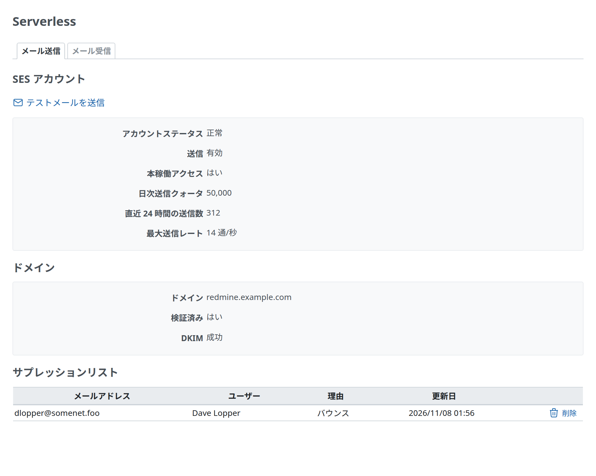
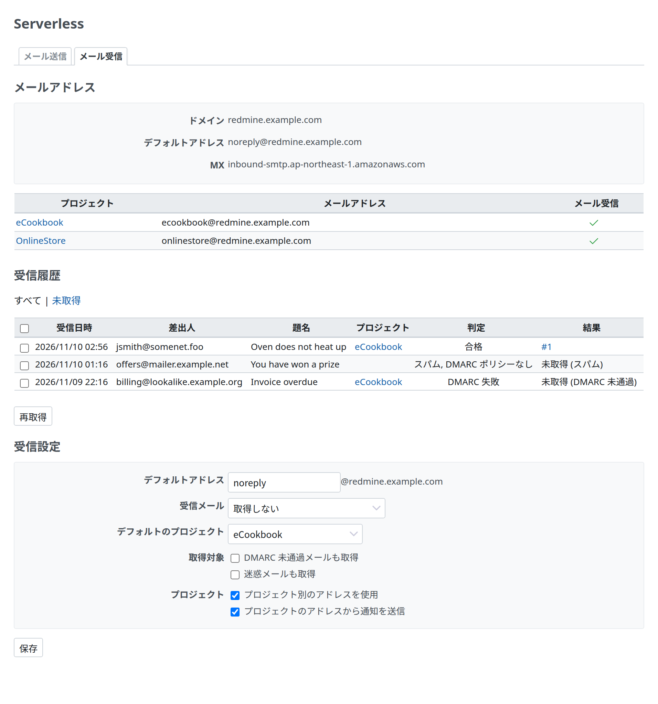
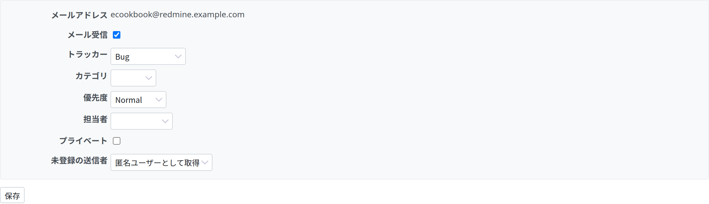

# 管理画面

Redmine Serverless SES の管理画面です。Redmine の管理者だけが開けます(`require_admin`)。プロジェクトのメール設定だけは、プラグインが追加するプロジェクトの権限を持つ人も変えられます(下記)。画面は、[Redmine Serverless](https://redmine-kit.github.io/redmine_serverless/ja/admin.html#the-serverless-menu) をインストールしているかどうかにかかわらず、すべての Redmine Serverless のプラグインが共有する Redmine の管理のメニューの「Serverless」の下の、「メール送信」と「メール受信」のタブになります。プロジェクトのメール設定は、代わりにプロジェクトの設定のタブになります。

この資料の仕様は、2026-11-08 時点の公式の情報と、Redmine 7.0.3 のソースで確認したものです。出典は [sources.md](https://redmine-kit.github.io/serverless/ja/sources.html) にあります。

| 項目 | 内容 |
| --- | --- |
| 秘密の値は出さない | AWS の認証情報と、受信したメールの本文は画面に出しません。SES の状態と MX のレコードは 1 分だけキャッシュします |
| 設定は画面で変える | 受信のオプションは、プラグインの設定(Redmine の `Setting.plugin_redmine_serverless_ses`、データベースに入る)にし、「メール受信」のタブで変えます。プラグインの一覧に「設定」のリンクは出ません |
| 操作を記録する | サプレッションリストからの削除、再取得、設定の変更は、誰が何をしたかを Redmine のログに書きます(`[redmine_serverless_ses] <ログイン> ...`) |
| 接続テスト | Redmine Serverless を入れているときは、その「ステータス」のタブの「接続テスト」で、SES v2 の `GetAccount` も呼びます([その admin.md](https://redmine-kit.github.io/redmine_serverless/ja/admin.html#status-and-connections))。結果は「送信: 有効、本稼働アクセス: はい」のように出ます |

## メール送信

| 項目 | 中身 | 取得元 |
| --- | --- | --- |
| SES アカウント | 「アカウントステータス」(`HEALTHY`、`PROBATION`、`SHUTDOWN` を、正常、レビュー対象、一時停止で出す)、「送信」(有効か一時停止)、「本稼働アクセス」(はいかいいえ。いいえはサンドボックスの中) | SES v2 の `GetAccount` |
| 送信の上限 | 「日次送信クォータ」、「直近 24 時間の送信数」、「最大送信レート」(例: 「14 通/秒」) | 同上 |
| ドメイン | 管理画面の送信元のアドレスのドメイン、「検証済み」か、DKIM の状態(成功、保留中、失敗、一時的な失敗、未開始) | SES v2 の `GetEmailIdentity` |
| サプレッションリスト | SES が送信を止めているアドレス。列は、メールアドレス、ユーザー(そのアドレスを持つ Redmine のユーザー)、理由(バウンスか苦情)、更新日。最初の 100 件 | SES v2 の `ListSuppressedDestinations` |
| 削除 | サプレッションリストのアドレスごとの「削除」のボタン。確認のあとで消す | SES v2 の `DeleteSuppressedDestination` |
| テストメールを送信 | 上の、Redmine の標準の「テストメールを送信」(管理 › 設定 の「メール通知」)へのリンク。同じ機能は追加しない | — |
| 失敗したジョブ | Redmine Serverless SQS を入れているときは、上の、その「ジョブ」の画面の、失敗したメールに絞った一覧へのリンク | — |

| 項目 | 内容 |
| --- | --- |
| サプレッションリストを出す理由 | バウンスや苦情があったアドレスは、SES がサプレッションリストに入れ、そこへは送らなくなります。Redmine からは送ったように見えるので、「通知が届かない」と言われたときに、この画面で確認できます。原因を直してから、アドレスを削除します |
| テストのメール | Redmine の標準のテストのメールは、画面の要求の中で送る(`deliver_now`)ので、`redmine-web` にも SES で送る権限を与えます([mail.md](https://redmine-kit.github.io/serverless/ja/mail.html#ses)) |

## メール受信

| 項目 | 中身 | 取得元 |
| --- | --- | --- |
| メールアドレス | 「ドメイン」(Redmine のドメイン。送信元のアドレスのドメイン)、「デフォルトアドレス」、「MX」(下記)。プロジェクト別のアドレスを使うときは、プロジェクトの一覧(プロジェクト、メールアドレス、メール受信) | プラグインの設定と、プロジェクトのメール設定 |
| MX | Redmine のドメインの MX のホスト。SES の受信のエンドポイントになっているかを確認する。問い合わせに失敗すると「不明」、MX のレコードがなければ「なし」 | DNS の問い合わせ。タイムアウトは 2 秒 |
| 受信履歴 | 受信日時、差出人、題名、プロジェクト、判定(SES のウイルス、スパム、DMARC の判定。例: 「ウイルス PASS, スパム PASS, DMARC FAIL」)、結果(下記)。新しい 100 件。一覧の上の「すべて \| 未取得」で絞り込める | プラグインの表(下記) |
| 再取得 | 一覧のチェックボックスでメールを選ぶ。Redmine のチケットの一覧と同じく、見出しの行のチェックボックスで全部を選べる。「再取得」で、選んだメールをもう一度取得する | メールごとのジョブ(`ServerlessReimportMailJob`。Serverless では SQS に入り、`redmine-worker` が取り込む) |
| 受信設定 | 「デフォルトアドレス」(`@` の前)、「デフォルトアドレス宛て」(「取得しない」(既定)か「デフォルトのプロジェクトで取得」)、「デフォルトのプロジェクト」、「取得対象」(「DMARC 未通過メールも取得」と「迷惑メールも取得」。どちらも既定はオフで、画面に注記を出す。ウイルス判定メールは取得しない)、「プロジェクト」(「プロジェクト別のアドレスを使用」、「プロジェクトのアドレスから通知を送信」) | プラグインの設定(画面で変える)。[receiving.md](receiving.md#spoofing-and-spam) も参照 |

| 結果 | 意味 |
| --- | --- |
| チケット(例: `#123`)か「取得済み」 | 取り込んだ。チケットを作ったか、注記を追加した |
| 未取得 (判定なし) | SES の判定がない(イベントを通して受け取っていないメール) |
| 未取得 (ウイルス) | ウイルスの判定が `PASS` でない |
| 未取得 (スパム) | スパムの判定が `PASS` でなく、「迷惑メールも取得」がオフ |
| 未取得 (DMARC 未通過) | DMARC の判定が `PASS` でなく、「DMARC 未通過メールも取得」がオフ |
| 未取得 (自動返信) | 自動の返信([receiving.md](receiving.md#importing)) |
| 未取得 (プロジェクトなし) | 受け取るプロジェクトがない。または、「デフォルトアドレス宛て」が「取得しない」のときの、デフォルトアドレス宛てのメール |
| 取得エラー | Redmine が取り込まなかった(たとえば、「取得しない」での未登録の送信者や、権限のない送信者)。理由は Redmine のログにある |

| 項目 | 内容 |
| --- | --- |
| 取得の記録 | `redmine_serverless_ses:receive_mail` は、メールごとの結果を、プラグインの表(`serverless_received_mails`)に入れます。送信者、件名、SES のイベントのエンベロープの宛先と判定、プロジェクト、作ったチケットや追加した注記です。本文は入れず、メールのバケットのキー(`inbound/` か `processed/`)を入れます。再取得は、同じ記録を書き換えます。90 日より古い記録は、`rake redmine_serverless_ses:prune_records` が消します。Serverless は毎日動かします([security.md](https://redmine-kit.github.io/serverless/ja/security.html#retention-periods)) |
| 未取得のメール | `inbound/` に残り、原因を直してから再取得できます |
| 再取得 | 画面は `redmine-task` を直接は呼ばず、キューにジョブを入れます。こうすると、`redmine-web` に、メールのバケットを読む権限も、Lambda を呼ぶ権限も要りません。Redmine Serverless SQS を入れていれば、このジョブのクラスを、実行を許可するジョブクラスに追加します |
| 受信設定を画面に置く理由 | デフォルトのプロジェクトを変えるたびにデプロイしなくて済みます。`redmine_serverless_ses:receive_mail` は、動くたびにデータベースから設定を読みます |

## プロジェクトのメール設定

プロジェクトごとのアドレスを使うとき、プロジェクトの設定に「メール」のタブを追加します。プロジェクトごとのアドレスを設定します([receiving.md](receiving.md#addresses-per-project))。設定は、プラグインの表(`serverless_project_mail_settings`)に入ります。Redmine の設定(`Setting`。名前と値)は Redmine 全体のものだけで、プロジェクトごとの設定の表がないためです。プロジェクトを削除すると、その行も消えます。

| 項目 | 中身 |
| --- | --- |
| メールアドレス | `<識別子>@<Redmine のドメイン>`。表示のみ。識別子をアドレスにできないプロジェクトは `-` になり、メールを受け取れない([receiving.md](receiving.md#addresses-per-project)) |
| メール受信 | チェックボックス。既定はオフ |
| 既定の値 | 作るチケットのトラッカー、カテゴリー、優先度、担当者、プライベート |
| 未登録の送信者 | 「取得しない」(既定)、「匿名ユーザーとして取得」、「ユーザーを作成」(Redmine の `unknown_user` の `ignore`、`accept`、`create`) |

| 項目 | 内容 |
| --- | --- |
| 変えられる人 | Redmine の管理者と、プラグインが追加するプロジェクトの権限「メール設定の管理」を持つメンバーです |
| 未登録の送信者のメールを取得するとき | 問い合わせの窓口のように、外の人からのメールを受けるときに使います。迷惑メールが増えるので、DMARC の確認は外しません([receiving.md](receiving.md#spoofing-and-spam)) |

## 権限

これらの画面のために、Redmine の web の要求を動かすロールに、SES の状態を読む権限と、サプレッションリストからアドレスを外す権限を与えます。一覧と例のポリシーは [iam.md](iam.md) にあります。

## テスト

画面ごとに、Redmine の機能のテストがあります。SES には SDK の応答のスタブを使います([testing.md](https://redmine-kit.github.io/serverless/ja/testing.html#administration-pages))。

このページの画面のスクリーンショットは、`bin/screenshots` で撮ります(Docker の中のヘッドレスの Chromium と、Redmine のテストのデータと、例の SES の応答と受信したメール)。画面を変えたら実行します。

## 用語

画面の語は、SES の AWS のコンソールとドキュメントの日本語に合わせています(2026-11-10 に確認)。

| 画面(ja / en) | AWS の語 | 出典 | 状態 |
| --- | --- | --- | --- |
| アカウントステータス / Account status。正常 / Healthy、レビュー対象 / Under review、一時停止 / Paused | `EnforcementStatus`(`HEALTHY`、`PROBATION`、`SHUTDOWN`) | 「アカウントステータス」「正常」「一時停止」「レビュー対象」(https://docs.aws.amazon.com/ja_jp/ses/latest/dg/faqs-enforcement.html) | ドキュメント |
| 本稼働アクセス / Production access | `ProductionAccessEnabled` | https://docs.aws.amazon.com/ja_jp/ses/latest/dg/manage-sending-quotas.html。第三者の記事は、コンソールの表示を「本番アクセス」としている(https://blog.serverworks.co.jp/ses-sandbox) | コンソールで要確認 |
| 日次送信クォータ / Daily sending quota | `SendQuota.Max24HourSend` | https://docs.aws.amazon.com/ja_jp/ses/latest/dg/monitor-sending-activity-console.html | ドキュメント |
| 最大送信レート / Maximum send rate | `SendQuota.MaxSendRate` | https://docs.aws.amazon.com/ja_jp/ses/latest/dg/monitor-sending-activity-console.html | ドキュメント |
| 検証済み / Verified | `VerifiedForSendingStatus` | 「検証済み ID」(https://docs.aws.amazon.com/ja_jp/ses/latest/dg/send-email-authentication-dkim-easy-managing.html) | ドキュメント |
| DKIM の成功 / Successful、保留中 / Pending、失敗 / Failed、一時的な失敗 / Temporary failure、未開始 / Not started | `DkimAttributes.Status`(`SUCCESS`、`PENDING`、`FAILED`、`TEMPORARY_FAILURE`、`NOT_STARTED`) | ドキュメントは API の値を英語のまま書く。日本語の値は、このプラグインで付けたもの | コンソールで要確認 |
| サプレッションリスト / Suppression list。バウンス / Bounce、苦情 / Complaint。削除 / Remove | `ListSuppressedDestinations`(`Reason`: `BOUNCE`、`COMPLAINT`)、`DeleteSuppressedDestination` | https://docs.aws.amazon.com/ja_jp/ses/latest/dg/sending-email-suppression-list.html | ドキュメント |
| 判定 / Verdicts のスパム / Spam、ウイルス / Virus | `spamVerdict`、`virusVerdict` | https://docs.aws.amazon.com/ja_jp/ses/latest/dg/receiving-email-concepts.html。値の `PASS` と `FAIL` は、ドキュメントと同じく英語のまま | ドキュメント |
